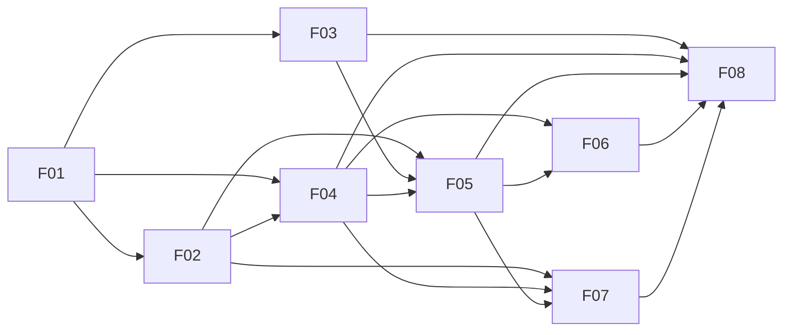

# PRD — Catraca (MVP)

> Fonte das regras de negócio: [`docs/brief.md`](brief.md) (R01–R13, gateway simulado, API de parceiros).
> Este PRD transforma o brief em features com ID, o que cada uma **provê** e **consome**, o grafo de dependências, as waves e os critérios de aceite, inclusive os que atravessam features (critérios **cross-feature**, `XC-…`).

## 1. Visão

A Catraca vende ingressos para eventos pequenos (shows em bar, workshops, meetups). O MVP precisa funcionar **quando as features se encontram**. A tentativa anterior falhou na integração: evento cancelado deixava gente entrar, estorno virava receita e houve overbooking sob concorrência. Por isso cada aresta do grafo de dependências tem ao menos um critério cross-feature, e o Fluxo do avaliador (seção 9) é rastreado até os critérios.

### Personas

| Persona | Como entra | O que faz |
|---|---|---|
| Visitante | sem login | vê a vitrine |
| Participante | cadastro próprio (nome, e-mail, senha) | entra, sai, compra ingressos, vê "Meus ingressos" |
| Organizador | conta da seed (sem cadastro pelo produto) | cria e opera os próprios eventos na área de organizador |
| Parceiro | chave `X-Api-Key` | lista eventos, compra e consulta ingressos pela API de parceiros |

### Glossário de status do ingresso

| Rótulo (UI) | Valor (API / banco) | Quando |
|---|---|---|
| pendente | `pending` | compra criada, aguardando o gateway |
| confirmado | `confirmed` | gateway aprovou |
| recusado | `declined` | gateway recusou |
| cancelado | `cancelled` | estava pendente quando o evento foi cancelado |
| estornado | `refunded` | estava confirmado quando o evento foi cancelado |

O check-in não é um status: é registrado em `checked_in_at` (na API, `checkedIn: boolean`).

Status do evento: `draft` (rascunho), `published` (publicado), `cancelled` (cancelado).

**Vagas ocupadas** = ingressos `pending` + `confirmed`. **Vagas disponíveis** = lotação − ocupadas (0 se o evento está cancelado) (R05).

### Decisões de produto e arquitetura (resumo; detalhe nas specs)

- Stack: Node.js 22 + TypeScript, Fastify, páginas server-side em EJS (formulários + redirect), PostgreSQL 16. Tudo roda via Docker Compose.
- Endereços: produto (`$WEB`) e API de parceiros (`$API`) no mesmo servidor, `http://localhost:3000`.
- Fuso: `America/Sao_Paulo` (UTC−03:00). Datas da UI usam `datetime-local` interpretado nesse fuso; a API devolve ISO 8601 com offset `-03:00`.
- Concorrência (R07/R03/R11): toda operação que lê ou altera vagas ou preço de um evento faz `SELECT … FOR UPDATE` na linha do evento (`lockEvent`), dentro de uma transação. Isso vale para compra, edição (lotação **e** preço), publicação e cancelamento. A compra lê o preço dentro do lock.
- Gateway assíncrono: a compra grava o ticket `pending` + uma linha em `payments` e, depois do commit, aciona o dispatcher imediatamente (polling de 250 ms como rede de segurança). O dispatcher processa cada pagamento **concorrentemente** (uma promessa por pagamento) e aplica o resultado em uma transação que trava a linha do evento com `FOR SHARE`. O resultado só é aplicado se o ticket ainda estiver `pending` **e** o evento não estiver `cancelled`. Como o cancelamento segura `FOR UPDATE` no mesmo evento, as duas operações são serializadas.
- Atrasos do gateway simulado (dentro das faixas do brief): finais 0001/0002/outros em **2–4 s**; 0003/0004 em **30–40 s**. Somados à latência do dispatcher (≤ 300 ms), garantem `confirmed` em < 5 s para o 0001.
- IDs: o id de evento é a string `evt_…`, a mesma na URL da página de gestão (`/org/events/evt_…`), na vitrine e na API. Ingressos usam `tkt_…`.
- Schema completo em F01: as features seguintes não criam migrações nas waves paralelas. Quando uma migração for indispensável, ela usa prefixo de timestamp para não colidir.

## 2. Features

| ID | Feature | Provê | Consome |
|---|---|---|---|
| F01 | Fundação & Harness | servidor Fastify + EJS e layout base; pool `db` e helper `withTransaction`; migrações com o schema completo (`users`, `sessions`, `events`, `tickets`, `payments`); seed idempotente (org A, org B, participante); `docker compose` + `npm run up/down/gates`; helpers de teste; `/healthz`; AGENTS.md; CI | — |
| F02 | Contas & Acesso | `/signup`, `/login`, `/logout`; sessão por cookie; `request.user`; guards `requireParticipant` e `requireOrganizer` | F01 |
| F03 | Gateway simulado & Dispatcher | `PaymentGateway` / `SimulatedGateway` (tabela de finais e atrasos, `GATEWAY_DELAY_SCALE`); `isValidCardNumber`; `enqueuePayment(client, ticketId, card)`; dispatcher em background com aplicação guardada do resultado (`pending → confirmed/declined`) | F01 |
| F04 | Eventos | criação/edição/publicação de evento (R01–R04); vitrine `/` e `/events/:id`; área `/org/events` e página de gestão `/org/events/:id` com slots de painel, check-in e cancelamento; `listOnSaleEvents`, `getSeatCounts`/`availableSeats`, `lockEvent`, `getOwnedEvent` | F01, F02 |
| F05 | Compras & Meus ingressos | `purchaseTicket({eventId, channel, userId?, buyerEmail, cardNumber})` concorrente-seguro (R05–R09); compra na vitrine; mensagem `Ingressos esgotados`; `/me/tickets`; `findTicketById`, `findTicketByCode` | F02, F03, F04 |
| F06 | API de parceiros | `GET /api/partner/events`, `POST /api/partner/events/:eventId/purchases`, `GET /api/partner/tickets/:ticketId` com o contrato fixo e autenticação `X-Api-Key` | F04, F05 |
| F07 | Check-in & Painel | check-in na página de gestão com as mensagens de R10 na ordem; painel de R12 (vendas da vitrine e da API) | F02, F04, F05 |
| F08 | Cancelamento | cancelamento irreversível de evento publicado (R11): estorno/cancelamento dos ingressos, bloqueio de edição, publicação e venda | F03, F04, F05, F06, F07 |

## 3. Grafo de dependências

Uma seta `A --> B` significa: **B consome o que A provê**. Dependências transitivas sobre a infraestrutura de F01 (`db`, `withTransaction`, layout, helpers de teste) foram omitidas das features F05–F08, porque elas as recebem via F02/F03/F04. F06 valida o corpo com `validatePurchaseInput`, re-exportado por F05 (que encapsula `isValidCardNumber` de F03); por isso F06 não consome F03 diretamente.
A integração F06 × F07 (o campo `checkedIn` da API reflete o check-in) não é uma aresta, porque as duas ficam na mesma wave paralela. Ela é verificada na feature integradora F08 (`XC-F08-F06-02`) e no Fluxo do avaliador.

## 4. Waves

| Wave | Features | Execução |
|---|---|---|
| W0 | F01 | sequencial |
| W1 | F02, F03 | **paralela** (branches/worktrees separadas, PRs) |
| W2 | F04 | sequencial |
| W3 | F05 | sequencial |
| W4 | F06, F07 | **paralela** (branches/worktrees separadas, PRs) |
| W5 | F08 | sequencial |

Uma feature só começa quando todas as features que ela consome estão `done` na `main`. Dentro de uma wave paralela, as features não dependem uma da outra.

## 5. Critérios de aceite por feature

Formato: `AC-Fxx-nn [regras]`. Cada critério é verificável por comando, requisição HTTP, teste automatizado ou efeito observável na página.

### F01 — Fundação & Harness

- **AC-F01-01** Em um clone limpo, `npm run up` (sem `npm install` nem nenhum outro passo) constrói as imagens, sobe Postgres e app, aplica as migrações e roda a seed. O comando **só retorna quando** `GET /healthz` responde `200` em `http://localhost:3000` com a seed concluída (`docker compose up --wait` + healthcheck).
- **AC-F01-02** `npm run down` encerra tudo o que a subida iniciou: nenhum container do projeto aparece em `docker ps` e nenhuma porta que a subida abriu responde (só a do produto é publicada; o Postgres não é exposto no host).
- **AC-F01-03** `npm run up` → `npm run down` → `npm run up` funciona sem erro. A seed é reexecutável: depois de várias execuções existem exatamente 2 organizadores e 1 participante da seed.
- **AC-F01-04** `npm run gates` executa lint, typecheck e testes automatizados (vitest, com Postgres efêmero), retorna código 0 na `main` e não deixa containers rodando. Funciona em um clone limpo sem nenhum passo prévio (roda em container, sem exigir `npm install` no host) e não derruba nem interfere nos containers do produto que estiverem de pé.
- **AC-F01-05** O modo padrão não exige nenhuma chave de pagamento nem variável de ambiente: `GATEWAY_DELAY_SCALE` tem default `1`, `PARTNER_API_KEY` tem default documentado e não existe `.env` obrigatório.
- **AC-F01-06** O schema impõe as invariantes: `events.capacity >= 1`, `events.price_cents > 0`, `tickets.code` único, `tickets.status` ∈ {pending, confirmed, declined, cancelled, refunded}, `events.status` ∈ {draft, published, cancelled}, `tickets.price_cents` gravado por ingresso.
- **AC-F01-07** `AGENTS.md` na raiz contém os comandos de subir, derrubar e gates, as regras do projeto e o mapa dos artefatos; `CLAUDE.md` aponta para ele.
- **AC-F01-08** `CATRACA_PORT` e `COMPOSE_PROJECT_NAME` permitem dois ambientes simultâneos (duas worktrees) sem conflito de porta ou de container.
- **AC-F01-09** O `README.md` tem as seções do Entregável: Como rodar (pré-requisitos, up/down/gates), Endereços (`$WEB`, `$API`), Credenciais (org A, org B, participante da seed e chave de parceiro), Mapa dos artefatos (PRD, pastas das features, estado, AGENTS.md, links dos PRs das waves paralelas) e Decisões (stack, R07, gateway assíncrono, isolamento da avaliação). As credenciais do README funcionam no produto subido.
- **AC-F01-10** `state/project-state.json` lista todas as features com status e caminho do relatório mais recente, e todos os caminhos existem.

### F02 — Contas & Acesso

- **AC-F02-01** Um visitante cria uma conta de participante em `/signup` com nome, e-mail e senha e fica logado. E-mail já usado, e-mail mal formado ou campos vazios são rejeitados com mensagem.
- **AC-F02-02** Participante e organizador (seed) entram em `/login` e saem em `/logout`. Credenciais erradas são rejeitadas sem criar sessão.
- **AC-F02-03** [R13] Visitante que acessa qualquer rota `/org/*` é redirecionado para `/login`. Participante logado que acessa `/org/*` recebe `403` sem nenhum dado de evento.
- **AC-F02-04** Não existe cadastro de organizador pelo produto: `/signup` sempre cria `role = participant`, mesmo que o formulário seja adulterado.
- **AC-F02-05** `requireParticipant` barra visitante (redirect para `/login`) e organizador (`403`) nas rotas de participante.
- **AC-F02-06** A senha é guardada com hash (scrypt + salt), nunca em texto puro. O cookie de sessão é `HttpOnly` e `SameSite=Lax`.

### F03 — Gateway simulado & Dispatcher

- **AC-F03-01** [R08] Com `GATEWAY_DELAY_SCALE=1`, o `SimulatedGateway` responde conforme o final do cartão, dentro das faixas do brief: `0001` aprovado em 2–4 s; `0002` recusado em 2–4 s; `0003` aprovado em 30–40 s; `0004` recusado em 30–40 s; qualquer outro final recusado em 2–4 s.
- **AC-F03-02** `isValidCardNumber` aceita exatamente 16 dígitos (`^\d{16}$`) e rejeita qualquer outra entrada (`123`, 15 ou 17 dígitos, letras, vazio, `null`).
- **AC-F03-03** [R08] Depois de `enqueuePayment`, o dispatcher aplica o resultado ao ticket: aprovado → `confirmed`, recusado → `declined`. O `payments` correspondente termina em `done` com o resultado.
- **AC-F03-04** [R06] `enqueuePayment` só grava a linha de `payments` e retorna sem esperar o gateway (< 200 ms, mesmo para o cartão `0003`).
- **AC-F03-05** [R11] O resultado do gateway é aplicado em uma transação que trava o evento com `FOR SHARE`, e só se o ticket ainda estiver `pending` **e** o evento não estiver `cancelled`. Ticket `cancelled` ou `refunded` não muda quando a resposta chega depois, e um evento cancelado nunca ganha ticket `confirmed`, nem em corrida com o cancelamento.
- **AC-F03-06** `GATEWAY_DELAY_SCALE` multiplica todos os atrasos (ex.: `0.01` → 0003 responde em 0,3–0,4 s). O default é `1`.
- **AC-F03-07** Pagamentos que estavam `requested`/`in_flight` quando a app parou são processados depois que ela sobe de novo (nenhum ticket fica `pending` para sempre).
- **AC-F03-08** [R08] O dispatcher processa pagamentos **concorrentemente** e com baixa latência: com `GATEWAY_DELAY_SCALE=1`, 5 pagamentos `0001` enfileirados ao mesmo tempo ficam todos `confirmed` em ≤ 5 s, medidos a partir do `enqueuePayment`. Isso se repete em 10 rodadas, e a latência de coleta é ≤ 300 ms.

### F04 — Eventos

- **AC-F04-01** [R01] O organizador cria um evento com nome, data e hora de início, local, lotação (inteiro ≥ 1) e preço em reais (> 0, ex.: `100,00` ou `100.00`). Campo faltando, lotação 0 ou não inteira e preço ≤ 0 são rejeitados com mensagem, sem criar evento.
- **AC-F04-02** [R01] Data de início no passado (ex.: ontem) é rejeitada ao criar e ao editar.
- **AC-F04-03** [R02] Todo evento nasce `draft`. Rascunho não aparece na vitrine `/`, `/events/:id` responde 404 para rascunho (e para evento cancelado), e `listOnSaleEvents()` não o retorna.
- **AC-F04-04** [R02] Ao publicar, o evento aparece na vitrine com nome, data, local, preço e vagas disponíveis, e `listOnSaleEvents()` passa a retorná-lo.
- **AC-F04-05** [R04] Cada evento tem a página de gestão `/org/events/:id`, com os dados do evento, o formulário de edição, a ação de publicar (quando rascunho) e os slots de painel, check-in e cancelamento.
- **AC-F04-06** [R03] Aumentar a lotação é aceito. Reduzir a lotação para um valor menor que as vagas ocupadas é rejeitado com mensagem; reduzir para um valor ≥ ocupadas é aceito. A verificação acontece sob `lockEvent`.
- **AC-F04-07** [R05] `getSeatCounts(eventId)` devolve ocupadas = pending + confirmed e disponíveis = lotação − ocupadas, ou 0 se o evento está `cancelled`.
- **AC-F04-08** [R13] `/org/events` lista só os eventos do organizador logado. `/org/events/:id` (GET ou qualquer POST) de evento de outro organizador responde 404 genérico, sem nome, números nem ingressos do evento.
- **AC-F04-09** [R03] Alterar o preço muda só `events.price_cents`. Ingressos já existentes mantêm o `price_cents` gravado na compra.
- **AC-F04-10** [R01] Na edição, os campos continuam validados como na criação (lotação ≥ 1, preço > 0, data futura).
- **AC-F04-11** [R04] O id do evento é a string `evt_…`, a mesma na URL da página de gestão, na vitrine (`/events/evt_…`) e no `id` da API. A página de gestão mostra o id.

### F05 — Compras & Meus ingressos

- **AC-F05-01** [R06] O participante logado compra um ingresso em `/events/:id` informando um cartão de 16 dígitos. O ingresso nasce `pending` e a resposta (redirect para "Meus ingressos") chega sem esperar o gateway (< 1 s, mesmo com o cartão `0003`).
- **AC-F05-02** Um cartão que não tem 16 dígitos é rejeitado com mensagem, **antes** de criar o ingresso (nenhuma linha nova em `tickets`).
- **AC-F05-03** [R05, R06] Um ingresso pendente já ocupa vaga: com lotação 1 e uma compra pendente, as vagas disponíveis são 0.
- **AC-F05-04** [R07] Sem vaga disponível, a vitrine exibe `Ingressos esgotados` no lugar do formulário de compra. Uma tentativa de compra feita sem vaga (ex.: formulário aberto antes de esgotar) também responde `Ingressos esgotados` e não cria ingresso.
- **AC-F05-05** [R07] Concorrência: 30 chamadas simultâneas de `purchaseTicket` em um evento novo de lotação 5 resultam em exatamente 5 sucessos e 25 `sold_out`, e as ocupadas nunca passam de 5. O teste roda 20 rodadas, cada uma em um evento novo.
- **AC-F05-06** [R09] Cada ingresso recebe um código único de 8 caracteres `[A-Z2-9]`, e uma colisão gera um novo código.
- **AC-F05-07** [R09] Em `/me/tickets`, o participante vê, para cada ingresso que comprou, o nome do evento, o status com o rótulo em português e o código. Ele não vê ingressos de outros participantes.
- **AC-F05-08** [R03, R12] Cada ingresso grava `price_cents` igual ao preço do evento no momento da compra.
- **AC-F05-09** [R02] Compra em evento inexistente, `draft` ou `cancelled` falha com `event_not_available` (a vitrine responde 404).
- **AC-F05-10** [R06] `purchaseTicket` aceita `channel: 'partner'` sem `userId`, só com `buyerEmail`. Esses ingressos contam para a lotação como os da vitrine e não ficam vinculados a nenhuma conta: uma compra de parceiro com o mesmo e-mail de um participante não aparece no `/me/tickets` dele.
- **AC-F05-11** [R08] O gateway recusa (`0002`/`0004`/outros) → `declined`, e a vaga é liberada (as disponíveis aumentam em 1).
- **AC-F05-12** [R07] `purchaseTicket` verifica nesta ordem: entrada inválida (`invalid_request`: e-mail mal formado, cartão sem 16 dígitos) → evento indisponível (`event_not_available`) → sem vaga (`sold_out`). Lotação e preço são lidos dentro do `lockEvent`. A função é exportada junto com `validatePurchaseInput`.

### F06 — API de parceiros

- **AC-F06-01** As três rotas, sem `X-Api-Key` ou com chave inválida, respondem `401` com `{"error":"unauthorized"}`.
- **AC-F06-02** [R02, R05] `GET /api/partner/events` responde `200` com um array contendo só eventos publicados e não cancelados, cada item com exatamente `id`, `name`, `startsAt` (ISO 8601 com offset), `priceCents` (inteiro) e `availableSeats` (R05).
- **AC-F06-03** [R06] `POST /api/partner/events/{eventId}/purchases` com corpo válido responde `202` com `{"ticketId","code","status":"pending"}`.
- **AC-F06-04** A ordem de validação da compra é: corpo inválido (campo faltando, e-mail mal formado, cartão sem 16 dígitos) → `422 {"error":"invalid_request"}`; evento inexistente, rascunho ou cancelado → `404 {"error":"event_not_available"}`; sem vaga → `409 {"error":"sold_out"}`.
- **AC-F06-05** [R07] O comando do passo 15 do Fluxo do avaliador (30 `curl` simultâneos em um evento novo de lotação 5) resulta em exatamente `5 × 202` e `25 × 409`, em várias rodadas com eventos novos.
- **AC-F06-06** [R09] `GET /api/partner/tickets/{ticketId}` responde `200` com `ticketId`, `code`, `eventId`, `status` e `checkedIn`. Um ticket inexistente responde `404 {"error":"ticket_not_found"}`.
- **AC-F06-07** [R08] Uma compra pela API com o cartão `0001` está `confirmed` em até 5 s. Com o cartão `0004`, ela fica `pending` até 30–40 s e depois `declined`, liberando a vaga.
- **AC-F06-08** A API é robusta aos defaults do framework:
  - A autenticação roda antes de qualquer parsing (`onRequest`), então até um corpo malformado sem chave → `401`.
  - JSON malformado, corpo que não é objeto, campos que não são string ou `Content-Type` ausente/errado → `422 {"error":"invalid_request"}` (nunca 400/415/500).
  - `eventId`/`ticketId` em formato inesperado → `404 event_not_available` / `404 ticket_not_found`.
  - `id`, `ticketId` e `eventId` são strings JSON. Os corpos de 202 e 200 têm **exatamente** os campos do contrato, e `status` usa os valores da API (`pending`, `confirmed`, `declined`, `cancelled`, `refunded`).

### F07 — Check-in & Painel

- **AC-F07-01** [R10] Na página de gestão, o organizador informa um código e vê a mensagem da **primeira** situação verdadeira, nesta ordem: `Ingresso inválido para este evento` (código inexistente ou de outro evento) → `Evento cancelado` → `Ingresso não confirmado` → `Ingresso já utilizado` → `Entrada liberada`.
- **AC-F07-02** [R10] `Entrada liberada` registra `checked_in_at`. O mesmo código, de novo, resulta em `Ingresso já utilizado`.
- **AC-F07-03** [R10] O código de um ingresso confirmado de **outro** evento resulta em `Ingresso inválido para este evento`, sem registrar check-in.
- **AC-F07-04** [R12] O painel mostra: Confirmados (confirmados, inclusive os já com check-in), Pendentes, Check-ins (confirmados com check-in), Vagas disponíveis (R05), Receita (soma de `price_cents` dos confirmados, formatada `R$ 350,00`, com espaço comum, não NBSP) e Estornados. Cada número tem um seletor estável (`data-metric="confirmed|pending|checkins|available|revenue|refunded"`).
- **AC-F07-05** [R12, R03] A receita usa o preço gravado em cada ingresso: 2 confirmados a R$ 100,00 + 1 a R$ 150,00 = `R$ 350,00`. Ingressos `refunded`, `declined`, `cancelled` e `pending` não entram na receita.
- **AC-F07-06** [R13] Check-in e painel só funcionam para o dono do evento. Um POST de check-in de outro organizador em `/org/events/:id/checkin` responde 404 sem dados e não registra nada.
- **AC-F07-07** [R10] O código é comparado sem diferenciar maiúsculas/minúsculas e ignorando espaços nas pontas.

### F08 — Cancelamento

- **AC-F08-01** [R11] A página de gestão de um evento publicado oferece "Cancelar evento". Evento rascunho ou já cancelado não pode ser cancelado (ação ausente; POST rejeitado).
- **AC-F08-02** [R11] Ao cancelar, em uma única transação sob `lockEvent`: evento → `cancelled` e, em um **único** `UPDATE … SET status = CASE …`, ingressos `confirmed` → `refunded` e `pending` → `cancelled`. O efeito é visível em ≤ 10 s (imediato). Um teste de corrida (cancelamento × 20 respostas do gateway simultâneas) nunca deixa um ticket `confirmed` em evento cancelado.
- **AC-F08-03** [R11, R02] Um evento cancelado sai da vitrine, `/events/:id` não oferece compra e `purchaseTicket` falha com `event_not_available`.
- **AC-F08-04** [R11] Um evento cancelado não pode ser editado nem republicado: a página de gestão não mostra formulário de edição nem botão de publicar, e POSTs de edição/publicação são rejeitados sem alterar nada.
- **AC-F08-05** [R11] Uma resposta do gateway que chega depois do cancelamento não altera o status (`cancelled` continua `cancelled`; `refunded` continua `refunded`).
- **AC-F08-06** [R13] Só o dono do evento pode cancelá-lo: o POST de cancelamento de outro organizador responde 404 e não altera nada.
- **AC-F08-07** [R05, R11] Em evento cancelado, as vagas disponíveis são 0.

## 6. Critérios cross-feature (um ou mais por aresta do grafo)

Formato: `XC-<consumidora>-<provedora>-nn`. Cada critério prova que o que a provedora entrega chega e funciona na consumidora. O contrato da feature indicada em "coberto em" mapeia o critério.

| Aresta | Critério | Coberto em |
|---|---|---|
| F01 → F02 | XC-F02-F01-01 | F02 |
| F01 → F03 | XC-F03-F01-01 | F03 |
| F01 → F04 | XC-F04-F01-01 | F04 |
| F02 → F04 | XC-F04-F02-01 | F04 |
| F02 → F05 | XC-F05-F02-01 | F05 |
| F03 → F05 | XC-F05-F03-01 | F05 |
| F04 → F05 | XC-F05-F04-01, XC-F05-F04-02 | F05 |
| F04 → F06 | XC-F06-F04-01 | F06 |
| F05 → F06 | XC-F06-F05-01, XC-F06-F05-02 | F06 |
| F02 → F07 | XC-F07-F02-01 | F07 |
| F04 → F07 | XC-F07-F04-01 | F07 |
| F05 → F07 | XC-F07-F05-01, XC-F07-F05-02, XC-F07-F05-03 | F07 |
| F03 → F08 | XC-F08-F03-01 | F08 |
| F04 → F08 | XC-F08-F04-01 | F08 |
| F05 → F08 | XC-F08-F05-01 | F08 |
| F06 → F08 | XC-F08-F06-01, XC-F08-F06-02 | F08 |
| F07 → F08 | XC-F08-F07-01 | F08 |

- **XC-F02-F01-01** [R13] Depois de `npm run up` em um clone limpo, as contas da seed (F01) entram por `/login` (F02): org A e org B caem na área de organizador e o participante cai na vitrine. Depois de `npm run down && npm run up`, as mesmas credenciais continuam funcionando.
- **XC-F03-F01-01** [R08] Com a app subida por `npm run up` no modo padrão (sem chave de pagamento), um ticket `pending` gravado no schema de F01 e enfileirado com `enqueuePayment` (cartão `0001`) fica `confirmed` em até 5 s, porque o dispatcher sobe junto com o servidor de F01.
- **XC-F04-F01-01** [R01] As invariantes do schema de F01 reforçam a validação de F04: mesmo contornando o formulário (insert direto), `capacity = 0` ou `price_cents = 0` é rejeitado pelo banco. O evento criado pelo org A da seed fica com `organizer_id` = id do org A.
- **XC-F04-F02-01** [R13] A área de organizador de F04 é protegida pelos guards de F02: visitante em `/org/events` → `/login`; participante → `403`; org B não vê E1 de A na lista e recebe 404 sem dados ao abrir `/org/events/<id de E1>`.
- **XC-F05-F02-01** [R09, R13] A compra na vitrine exige participante logado (F02): visitante que tenta comprar é levado para `/login`; o ingresso fica vinculado ao `user_id` da sessão; o "Meus ingressos" de outro participante não mostra esse ingresso.
- **XC-F05-F03-01** [R08, R05] Compra pela vitrine (F05) com o cartão `0001` vira `confirmed` em até 5 s pelo dispatcher de F03. Com o cartão `0002`, vira `declined` e as vagas disponíveis do evento voltam ao valor anterior à compra.
- **XC-F05-F04-01** [R03, R05] Ingressos pendentes criados por F05 contam na verificação de lotação de F04: com 2 compras pendentes em um evento de lotação 2, reduzir a lotação para 1 é rejeitado; aumentar para 3 é aceito, e uma nova compra volta a ser aceita.
- **XC-F05-F04-02** [R07, R02] A vitrine de F04 mostra `Ingressos esgotados` no lugar da compra quando as compras de F05 ocupam todas as vagas. A compra em evento `draft` de F04 é recusada.
- **XC-F06-F04-01** [R02, R05] A listagem da API (F06) usa `listOnSaleEvents`/`getSeatCounts` de F04: um evento rascunho criado pela UI não aparece; depois de publicado, aparece com `priceCents` = preço da UI × 100, `startsAt` = data/hora da UI e `availableSeats` = lotação.
- **XC-F06-F05-01** [R06, R07] As compras pela API (F06) passam por `purchaseTicket` (F05) e disputam as mesmas vagas da vitrine: em um evento de lotação 2 com 1 compra pela vitrine e 1 pela API, a próxima compra pela API responde `409 sold_out` e a vitrine mostra `Ingressos esgotados`.
- **XC-F06-F05-02** [R09] `GET /api/partner/tickets/{id}` (F06) também devolve ingressos comprados pela vitrine (F05), com o mesmo `code` e `status` exibidos em "Meus ingressos".
- **XC-F07-F02-01** [R13] Check-in e painel (F07) ficam atrás de `requireOrganizer` (F02) + dono do evento: participante e visitante não alcançam, e org B não vê o painel nem faz check-in em evento de A (404 sem dados).
- **XC-F07-F04-01** [R12, R05] "Vagas disponíveis" no painel (F07) é igual ao `getSeatCounts` de F04 e acompanha a mudança de lotação feita na edição (lotação 2 → 3 com 2 ocupadas: o painel passa de 0 para 1).
- **XC-F07-F05-01** [R12, R03] O painel conta ingressos de F05 dos dois canais (`web` e `partner`) e a receita usa o preço gravado em cada compra: 2 compras confirmadas a R$ 100,00, depois o preço muda para R$ 150,00 e mais 1 compra confirmada → Confirmados 3, Receita `R$ 350,00`.
- **XC-F07-F05-02** [R10] O check-in (F07) encontra ingressos de F05 pelo código, de qualquer canal:
  - código da vitrine confirmado → `Entrada liberada`;
  - código de parceiro `pending` ou `declined` → `Ingresso não confirmado`;
  - código confirmado de outro evento → `Ingresso inválido para este evento`.
- **XC-F07-F05-03** [R07, R12] Depois de 30 chamadas simultâneas de `purchaseTicket` (canal `partner`, cartão `0001`) em um evento novo de lotação 5, o painel (F07) mostra Confirmados 5 e Vagas disponíveis 0 em ≤ 10 s (gateway em escala 1).
- **XC-F08-F03-01** [R11, R08] Ingresso com o cartão `0003` (F03) ainda `pending` quando o evento é cancelado (F08) fica `cancelled`. Quando a resposta (aprovada) do gateway chega depois, ele continua `cancelled`. Um ingresso já `confirmed` vira `refunded` e continua assim.
- **XC-F08-F04-01** [R11, R02, R05] O evento cancelado (F08) some da vitrine de F04, a página de gestão de F04 não oferece edição nem publicação, e `getSeatCounts` devolve 0 vagas disponíveis.
- **XC-F08-F05-01** [R11, R09] Depois do cancelamento (F08), `purchaseTicket` de F05 recusa a compra com `event_not_available`, e "Meus ingressos" mostra `estornado` para o ingresso que estava confirmado e `cancelado` para o que estava pendente.
- **XC-F08-F06-01** [R11] Depois do cancelamento (F08), a API de F06 exclui o evento da listagem, responde `404 {"error":"event_not_available"}` à compra, e `GET /tickets/{id}` mostra `refunded` / `cancelled` em até 10 s.
- **XC-F08-F06-02** [R10] Integração F06 × F07, verificada na integradora F08 depois da W4: um ingresso comprado pela API (F06) e confirmado mostra `checkedIn: false` em `GET /api/partner/tickets/{id}`. Depois do `Entrada liberada` no check-in (F07), mostra `checkedIn: true`, com `status: "confirmed"`.
- **XC-F08-F07-01** [R10, R11, R12] Depois do cancelamento (F08), o check-in de F07 de um código antes confirmado resulta em `Evento cancelado` (ou a mensagem aparece no lugar do campo), e o painel mostra Confirmados 0, Pendentes 0, Check-ins 0, Vagas disponíveis 0, Receita `R$ 0,00` e Estornados igual ao número de estornados.

## 7. Matriz de rastreabilidade R01–R13

| Regra | Critérios |
|---|---|
| R01 | AC-F04-01, AC-F04-02, AC-F04-10, XC-F04-F01-01 |
| R02 | AC-F04-03, AC-F04-04, AC-F05-09, AC-F06-02, AC-F08-03, XC-F05-F04-02, XC-F06-F04-01, XC-F08-F04-01 |
| R03 | AC-F04-06, AC-F04-09, AC-F05-08, AC-F07-05, XC-F05-F04-01, XC-F07-F05-01 |
| R04 | AC-F04-05, AC-F04-11 |
| R05 | AC-F04-07, AC-F05-03, AC-F06-02, AC-F08-07, XC-F05-F03-01, XC-F05-F04-01, XC-F06-F04-01, XC-F07-F04-01, XC-F08-F04-01 |
| R06 | AC-F03-04, AC-F05-01, AC-F05-03, AC-F05-10, AC-F06-03, XC-F06-F05-01 |
| R07 | AC-F05-04, AC-F05-05, AC-F05-12, AC-F06-05, XC-F05-F04-02, XC-F06-F05-01, XC-F07-F05-03 |
| R08 | AC-F03-01, AC-F03-03, AC-F03-08, AC-F05-11, AC-F06-07, XC-F03-F01-01, XC-F05-F03-01, XC-F08-F03-01 |
| R09 | AC-F05-06, AC-F05-07, AC-F06-06, XC-F05-F02-01, XC-F06-F05-02, XC-F08-F05-01 |
| R10 | AC-F07-01, AC-F07-02, AC-F07-03, AC-F07-07, XC-F07-F05-02, XC-F08-F06-02, XC-F08-F07-01 |
| R11 | AC-F03-05, AC-F08-01 … AC-F08-05, AC-F08-07, XC-F08-F03-01, XC-F08-F04-01, XC-F08-F05-01, XC-F08-F06-01, XC-F08-F07-01 |
| R12 | AC-F05-08, AC-F07-04, AC-F07-05, XC-F07-F04-01, XC-F07-F05-01, XC-F07-F05-03, XC-F08-F07-01 |
| R13 | AC-F02-03, AC-F04-08, AC-F07-06, AC-F08-06, XC-F02-F01-01, XC-F04-F02-01, XC-F05-F02-01, XC-F07-F02-01 |

## 8. API de parceiros (contrato fixo)

Reproduzido literalmente de [`docs/brief.md`](brief.md#api-de-parceiros-contrato-fixo). Chave de parceiro padrão: `PARTNER_API_KEY` (valor no README). Os IDs têm o formato `evt_<10 chars>` e `tkt_<10 chars>`.

| Rota | Sucesso | Erros (na ordem) |
|---|---|---|
| `GET /api/partner/events` | `200` `[{id,name,startsAt,priceCents,availableSeats}]` | `401 unauthorized` |
| `POST /api/partner/events/{eventId}/purchases` | `202` `{ticketId,code,status:"pending"}` | `401 unauthorized` → `422 invalid_request` → `404 event_not_available` → `409 sold_out` |
| `GET /api/partner/tickets/{ticketId}` | `200` `{ticketId,code,eventId,status,checkedIn}` | `401 unauthorized` → `404 ticket_not_found` |

## 9. Fluxo do avaliador → critérios

| Passo | Critérios |
|---|---|
| 1 | AC-F01-01, AC-F01-05, AC-F01-09 |
| 2 | AC-F04-01, AC-F04-03, XC-F06-F04-01 |
| 3 | AC-F04-02 |
| 4 | AC-F04-04, AC-F04-11, AC-F06-02, XC-F06-F04-01 |
| 5 | AC-F02-01, AC-F03-08, AC-F05-01, AC-F05-07, XC-F05-F02-01, XC-F05-F03-01 |
| 6 | AC-F06-03, AC-F05-03, XC-F06-F05-01 |
| 7 | AC-F06-04, AC-F05-04, AC-F05-12, XC-F05-F04-02, XC-F06-F05-01 |
| 8 | AC-F03-01, AC-F03-08, AC-F05-11, AC-F06-06, AC-F06-07 |
| 9 | AC-F04-06, AC-F04-09, AC-F07-04, AC-F07-05, XC-F05-F04-01, XC-F07-F04-01, XC-F07-F05-01 |
| 10 | AC-F07-01, AC-F07-02, XC-F07-F05-02, XC-F08-F06-02 |
| 11 | AC-F04-08, AC-F02-03, AC-F07-03, XC-F04-F02-01, XC-F07-F02-01 |
| 12 | AC-F08-01, AC-F08-02, AC-F03-05 |
| 13 | AC-F08-03, AC-F08-04, XC-F08-F04-01, XC-F08-F06-01 |
| 14 | AC-F08-05, XC-F08-F03-01, XC-F08-F07-01 |
| 15 | AC-F03-08, AC-F05-05, AC-F06-05, XC-F07-F05-03 |
| 16 | AC-F06-01, AC-F06-04, AC-F06-06, AC-F06-08 |
| 17 | AC-F01-02, AC-F01-03, AC-F01-04, XC-F02-F01-01 |
| 18 | AC-F01-07, AC-F01-09, AC-F01-10 (e o processo: specs, contratos, relatórios, estado, PRs) |

## 10. Fora de escopo

Do enunciado:
- Deploy e qualquer ambiente além do local.
- Gateway de pagamento real, e-mail e notificações.
- App mobile e qualidade visual (nenhum critério avalia design).
- Cadastro de organizador pelo produto (organizadores vêm da seed).
- Mais de um ingresso por compra, mapa de assentos, cancelamento ou transferência de ingresso pelo participante.
- Atualização em tempo real (recarregar a página basta).
- Fuso horário além de `America/Sao_Paulo`.

Decisões deste PRD:
- Recuperação de senha, verificação de e-mail e edição de perfil.
- Exclusão de evento (rascunhos ficam; o cancelamento é a única forma de encerrar a venda).
- Despublicar evento (só existe o cancelamento, irreversível).
- Proteção CSRF por token e rate limiting (cookie `SameSite=Lax` basta para o MVP local).
- Paginação e busca na vitrine e na API.
- Reembolso financeiro real: "estornado" é só um status.
